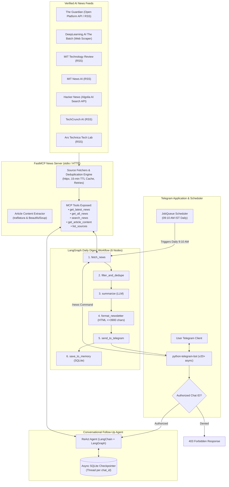

# 🤖 Daily AI News Telegram Bot

> **College Mini-Project**: An autonomous, intelligent Telegram bot that compiles and sends a daily AI news newsletter every morning, and engages in contextual follow-up discussions using conversation memory and Model Context Protocol (MCP) tool calling.

---

## 🏛️ System Architecture



---

## ✨ Features

- **Multi-Source News Aggregation**: Fetches and deduplicates from 7 authoritative tech sources:
  1. *The Guardian* (via Open Platform API with RSS fallback)
  2. *DeepLearning.AI (The Batch)* (editorial scraping)
  3. *MIT Technology Review* (RSS)
  4. *MIT News AI* (RSS)
  5. *Hacker News AI* (Algolia search endpoint)
  6. *TechCrunch AI* (RSS)
  7. *Ars Technica* (RSS)
- **Model Context Protocol (FastMCP)**: Standardized news server exposing typed tools over `stdio`, ready to transition to SSE or HTTP.
- **6-Node LangGraph State Machine**:
  1. `fetch_news` $\rightarrow$ 2. `filter_and_dedupe` $\rightarrow$ 3. `summarize` $\rightarrow$ 4. `format_newsletter` $\rightarrow$ 5. `send_to_telegram` $\rightarrow$ 6. `save_to_memory`.
- **Conversational Memory**: Chat with the bot about today's digest or past archives using an `AsyncSqliteSaver` checkpointer keyed by your Telegram `chat_id`.
- **On-Demand & Automated Dispatches**:
  - Automatically dispatched at **9:10 AM IST** daily.
  - On-demand dispatch anytime via the `/news` command.
- **Strict Access Control**: Protects the bot so only authorized chat IDs can trigger commands or queries.
- **Telegram-Safe Splitting**: Automatically splits long newsletters into chunks $\le 3900$ characters without breaking HTML formatting.

---

## 🚀 Setup & Installation

### 1. Prerequisites
- Python 3.11+
- Virtual environment tool (`venv`)
- A Telegram account

### 2. Clone and Setup Environment

```bash
git clone <your-repo-url>
cd Telegram_AI_Agent

# Create and activate virtual environment
python3.11 -m venv venv
source venv/bin/activate

# Install dependencies
pip install -r requirements.txt
```

### 3. Environment Configuration

Copy `.env.example` to `.env`:
```bash
cp .env.example .env
```

Fill in your configuration:
```env
# Telegram Bot Configuration
TELEGRAM_BOT_TOKEN=your_bot_token_from_botfather
TELEGRAM_ALLOWED_CHAT_IDS=your_chat_id_here

# LLM Configuration
GEMINI_API_KEY=your_gemini_api_key_here
GEMINI_MODEL=gemini-2.0-flash

# News API Keys
GUARDIAN_API_KEY=your_guardian_api_key_here

# Scheduling Configuration
DELIVERY_TIME=09:10
TIMEZONE=Asia/Kolkata

# Storage Configuration
DATABASE_PATH=data/bot_memory.db

# Logging
LOG_LEVEL=INFO
```

---

## 🤖 Telegram Bot & Chat ID Setup

### How to Create the Bot (BotFather)
1. Open Telegram and search for `@BotFather`.
2. Send `/newbot`.
3. Give your bot a display name (e.g. `Daily AI News`).
4. Give your bot a unique username ending in `bot` (e.g. `MyDailyAINewsBot`).
5. Copy the generated HTTP API token into `TELEGRAM_BOT_TOKEN` in `.env`.

### How to Get Your Chat ID
1. Search for `@userinfobot` or `@raw_data_bot` on Telegram.
2. Send `/start`.
3. Copy your numeric `Id` (e.g. `6803987604`) into `TELEGRAM_ALLOWED_CHAT_IDS` in `.env`.
4. **Important**: Search for your new bot on Telegram and click **Start** (`/start`) so Telegram allows the bot to message you!

---

## 🏃 Running the Application

### Start the Bot & Scheduler
```bash
source venv/bin/activate
python main.py
```

### Run the Standalone FastMCP Server
If you want to run or inspect the MCP News Server independently over `stdio`:
```bash
python -m mcp_server.server
```

### Run Unit Tests
```bash
pytest tests/
```

---

## 📱 Bot Commands

| Command | Description |
| :--- | :--- |
| `/start` | Displays welcome banner, status, and confirms Chat ID |
| `/news` | Triggers the 6-node LangGraph pipeline and sends the daily digest immediately |
| `/clear` | Resets SQLite conversation checkpointer memory for this chat |
| `/help` | Explains how to interact with the bot and ask follow-up questions |

---

## 💬 Example Follow-Up Questions

Once you receive the digest, you can naturally chat with the bot:
- *"Tell me more about the second story from The Guardian"*
- *"What did MIT report about neural computing today?"*
- *"Are there any trending discussions about OpenAI on Hacker News?"*
- *"Can you give me the full details of the TechCrunch satellite article?"*
- *"What was the main story in yesterday's digest?"*

---

## 🎓 Viva / Presentation Cheat Sheet ("How It Works")

When explaining this project to professors and evaluators, highlight these core concepts:

1. **Model Context Protocol (MCP)**:
   - MCP is the open standard created by Anthropic for connecting AI models to data sources and tools.
   - We implemented our own FastMCP server (`mcp_server/`) with 5 core tools: `get_latest_news`, `get_all_news`, `search_news`, `get_article_content`, and `list_sources`.
   - The news fetcher includes a 15-minute in-memory TTL cache and automatic retry logic with fallback to secondary feeds (e.g., Guardian API fallback to RSS).

2. **LangGraph State Machine**:
   - Rather than a fragile single-prompt script, the daily newsletter is compiled through a deterministic **6-node StateGraph**:
     `fetch_news` $\rightarrow$ `filter_and_dedupe` $\rightarrow$ `summarize` $\rightarrow$ `format_newsletter` $\rightarrow$ `send_to_telegram` $\rightarrow$ `save_to_memory`.
   - Each node transforms a typed `DigestState` dictionary, allowing clean error recovery if any node fails.

3. **Conversational Memory via Checkpointers**:
   - Follow-up conversations use LangGraph's `AsyncSqliteSaver` checkpointer.
   - Each Telegram `chat_id` serves as an isolated thread ID.
   - The agent retains the current day's digest in its working context while using MCP tools to fetch live article bodies or search across sources when deeper queries are requested.

---

## 🐳 Docker Deployment (Optional)

To run continuously on a free VPS or cloud host:

```bash
docker compose up -d --build
```

