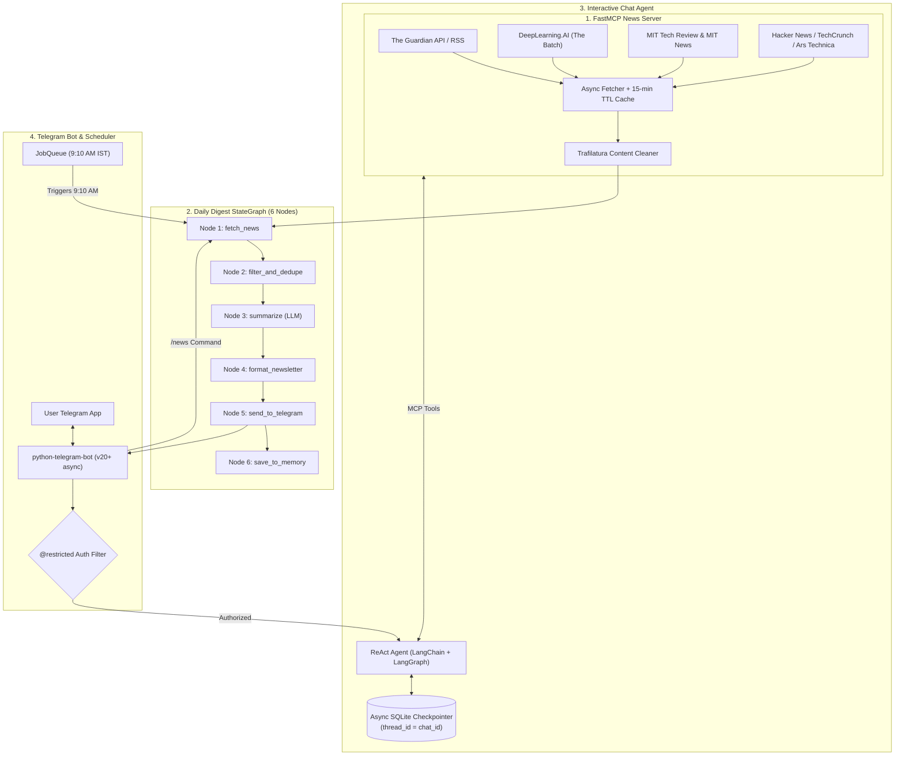

# 🎓 VIVA & PROJECT PRESENTATION PREPARATION GUIDE
## Project Title: Daily AI News Telegram Bot

---

## 1. Executive Summary (The 30-Second Pitch)

> **"Our project is an autonomous, production-grade Telegram bot that delivers an intelligent, multi-source AI news newsletter every morning at 9:10 AM IST, and acts as a conversational AI research assistant capable of answering contextual follow-up questions with persistent memory."**

### Core Highlights to Mention to Examiners:
1. **Decoupled Architecture**: News ingestion is separated into an open-standard **FastMCP (Model Context Protocol) Server**.
2. **Deterministic Orchestration**: Morning digest compilation is executed through a **6-Node LangGraph State Machine**, not a single brittle prompt.
3. **Conversational Memory**: Powered by LangGraph's **`AsyncSqliteSaver` checkpointer** keyed by Telegram `chat_id`.
4. **Resilience & Fault Tolerance**: In-memory TTL caching, exponential backoff retries, partial failure tolerance, and Telegram HTML chunking ($\le 3900$ chars).

---

## 2. System Architecture & End-to-End Workflow

---

## 3. "Why We Used What" vs "What Happens If We Don't"
*(This is the most critical section for your viva viva evaluation)*

### 1. Model Context Protocol (FastMCP)
* **What it is**: An open standard developed by Anthropic to standardize how AI applications discover, connect to, and invoke tools/data sources over `stdio` or HTTP/SSE.
* **Why we used it**:
  - Decouples news scraping from agent logic.
  - Exposes typed parameters and self-documenting docstrings (`list_sources`, `get_latest_news`, `get_all_news`, `search_news`, `get_article_content`).
  - Allows our news engine to be plugged into Claude Desktop, Cursor, or any MCP client without code modification.
* **What happens if we DON'T use it**:
  - **Spaghetti Code**: Scraping, HTML parsing, and bot logic become tightly coupled inside handlers.
  - **Zero Interoperability**: If we want to change or reuse the news fetchers in a web app or CLI, we would have to rewrite the entire data layer.
  - **No Standard Tool Calling**: The agent would require custom, brittle function-calling adapters rather than industry-standard MCP tooling.

---

### 2. LangGraph State Machine (Instead of a standard script)
* **What it is**: A graph-based orchestration framework for building cyclical and stateful multi-step AI workflows.
* **Why we used it**:
  - Breaks the newsletter creation into 6 explicit, isolated nodes:
    `fetch_news` $\rightarrow$ `filter_and_dedupe` $\rightarrow$ `summarize` $\rightarrow$ `format_newsletter` $\rightarrow$ `send_to_telegram` $\rightarrow$ `save_to_memory`.
  - Enforces a typed state contract (`DigestState`) between steps.
  - Provides deterministic observability and failure isolation.
* **What happens if we DON'T use it**:
  - **Monolithic Failure**: If we used a single prompt or procedural script, a network glitch from one source or a formatting error would crash the entire workflow.
  - **Uncontrollable Output**: Passing raw scraped articles directly to an LLM without intermediate deduplication nodes leads to duplicate stories and wasted token context.

---

### 3. LangGraph Checkpointer (`AsyncSqliteSaver`) for Memory
* **What it is**: An asynchronous checkpointing engine that serializes conversation graphs and message histories into SQLite (`data/bot_memory.db`).
* **Why we used it**:
  - Uses the user's Telegram `chat_id` as the isolated `thread_id`.
  - Persists state across bot restarts, server reboots, and sleep cycles.
  - Allows the agent to resolve contextual queries like: *"Tell me more about the second story from MIT."*
* **What happens if we DON'T use it**:
  - **Amnesia**: The bot becomes completely stateless. As soon as you ask a follow-up question, the bot forgets what it sent 2 seconds ago.
  - **Memory Loss on Deploy**: If stored in standard Python memory variables (e.g. a Python dictionary), every cloud redeploy or restart wipes all chat history.

---

### 4. `python-telegram-bot` (v20+ Async) & `JobQueue`
* **What it is**: The modern, fully asynchronous Python framework for Telegram Bot API with built-in task scheduling.
* **Why we used it**:
  - Built on `asyncio` for high concurrency without blocking the main event loop.
  - Integrated `JobQueue` (APScheduler-backed) handles timezone-aware scheduling (`Asia/Kolkata` at `09:10`).
* **What happens if we DON'T use it**:
  - **Event Loop Freezes**: Synchronous bot libraries (like old `telebot` or `requests`) freeze when fetching news or querying LLMs, making the bot unresponsive to other commands.
  - **Timezone Drift**: Using standard `time.sleep()` or OS cron jobs causes timezone mismatch, drift, and failed executions if daylight savings or clock adjustments occur.

---

### 5. `trafilatura` & BeautifulSoup Content Extraction
* **What it is**: Specialized algorithmic web scrapers designed to isolate real editorial article text from modern web pages.
* **Why we used it**:
  - Cleans and strips JavaScript, CSS, header banners, cookie consent popups, sidebars, and ads.
  - Returns pure, semantic text for deep summarization when the user asks for details via `get_article_content`.
* **What happens if we DON'T use it**:
  - **Garbage In, Garbage Out**: Passing raw HTML (`
`, `<script>`) to the LLM wastes 80%+ of the context window on advertisements, causing hallucinated summaries and high API costs.

---

### 6. In-Memory 15-Minute TTL Cache (`SimpleTTLCache`)
* **What it is**: A thread-safe, in-memory cache with automatic expiration (Time-To-Live).
* **Why we used it**:
  - Caches news queries so rapid requests (e.g. repeated `/news` triggers or multiple follow-up searches) do not hammer upstream news servers.
* **What happens if we DON'T use it**:
  - **Rate Limiting & IP Bans**: The Guardian API or The Batch will issue `429 Too Many Requests` or block the bot's IP address.
  - **Slow Response Times**: Every single chat interaction would incur 3-5 seconds of redundant network latency.

---

### 7. Telegram Message Chunker (`<= 3900` characters)
* **What it is**: A smart message splitting utility that splits text along paragraph boundaries (`\n\n`) while respecting HTML formatting tags.
* **Why we used it**:
  - Telegram has a strict hard limit of **4096 UTF-8 characters** per message.
* **What happens if we DON'T use it**:
  - **Crash on Delivery**: Telegram's API rejects the message with `telegram.error.BadRequest: Message is too long`, and the user receives nothing.
  - **Broken Formatting**: Naive string slicing (e.g. `text[:4096]`) cuts HTML tags in half (e.g. `<a hre`), causing `Can't parse entities: Tag not closed`.

---

### 8. Access Control Filter (`@restricted` Decorator)
* **What it is**: A Python decorator that verifies incoming `update.effective_chat.id` against `TELEGRAM_ALLOWED_CHAT_IDS`.
* **Why we used it**:
  - Protects private bot instances from unauthorized public access.
* **What happens if we DON'T use it**:
  - **Quota Drainage**: Anyone who discovers your bot username on Telegram could spam commands, burning your Gemini and Guardian API quotas in minutes.

---

### 9. Built-in Cloud Health Check Server (`http.server` on `$PORT`)
* **What it is**: A lightweight HTTP daemon thread that listens on the port assigned by cloud platforms (e.g. Render, Koyeb, Cloud Run).
* **Why we used it**:
  - Free tiers on cloud platforms require web services to bind to `$PORT` within 60 seconds to pass health checks.
* **What happens if we DON'T use it**:
  - **Deploy Failure**: Render marks the container as failed with: `Timed out waiting for port to become open`, killing the bot even if the Python code was error-free.

---

## 4. Probable Viva Questions & High-Scoring Answers

### Q1: "How does your bot handle when one of the news sources goes down or times out?"
> **Answer**:  
> "We implemented **graceful partial failure tolerance** in our FastMCP server using `asyncio.gather(*tasks, return_exceptions=True)`. Each fetcher also implements exponential backoff retries via `_get_with_retry()`. If, for example, The Guardian API fails, it automatically falls back to The Guardian RSS feed. If both fail, the exception is caught, logged, and the remaining 6 sources (MIT, The Batch, Hacker News, TechCrunch, Ars Technica) proceed normally without terminating the pipeline."

---

### Q2: "Why did you use LangGraph instead of just LangChain Chains?"
> **Answer**:  
> "LangChain Chains are linear and rigid (DAGs). LangGraph introduces **state machines** with typed state dictionaries (`DigestState`), cyclical graphs, and persistence checkpointers. This allows our daily digest to have explicit stages (filtering, deduplication, formatting, and delivery) with independent retry capabilities, and allows our chat agent to maintain isolated conversation memory across restarts."

---

### Q3: "What is the difference between stdio transport and SSE transport in MCP?"
> **Answer**:  
> - **stdio (Standard Input/Output)**: The client launches the MCP server as a subprocess and communicates via JSON-RPC messages over standard `stdin` and `stdout`. This has zero network overhead and optimal security for local/embedded tools.
> - **SSE (Server-Sent Events) / HTTP**: The MCP server runs as a separate web service over HTTP with Server-Sent Events. This is ideal when the MCP server is hosted on a different remote machine or shared across multiple agents.
> - In our project, FastMCP makes switching between the two a matter of changing a single argument (`mcp.run(transport='stdio')` vs `mcp.run(transport='sse')`).

---

### Q4: "How does the bot prevent SQLite database locks during async operations?"
> **Answer**:  
> "Standard `sqlite3` is synchronous and blocks the asyncio event loop during I/O. To prevent database locks and keep the bot responsive, we used **`AsyncSqliteSaver` backed by `aiosqlite`**, which executes SQLite queries asynchronously in dedicated background threads."

---

### Q5: "What prevents the bot from sleeping on Render's free tier?"
> **Answer**:  
> "Render's free tier puts inactive services to sleep after 15 minutes. We embedded a minimal HTTP health-check server inside `main.py` that listens on `$PORT`. By setting up an automated external ping every 10 minutes via cron-job.org or UptimeRobot, the service stays active 24/7 so the 9:10 AM IST scheduler always executes on time."

---

## 5. Live Demo Script (Step-by-Step for Presentation)

| Step | Action on Telegram | What You Explain to Evaluators |
| :---: | :--- | :--- |
| **1** | Send `/start` | Show authentication filter verifying your Chat ID and display the 9:10 AM schedule. |
| **2** | Send `/news` | Explain: *"The bot is now executing our 6-node LangGraph pipeline, querying all 7 news sources via our FastMCP server, deduplicating, and formatting with Telegram HTML chunking."* |
| **3** | Ask: *"Tell me more about the second story"* | Explain: *"Notice that I didn't specify the headline. The agent consults its SQLite checkpointer memory to identify which story was #2 in today's digest."* |
| **4** | Ask: *"What are developers saying on Hacker News today?"* | Explain: *"Here, the agent autonomously decides to call the MCP tool `search_news` or `get_latest_news` for Hacker News."* |
| **5** | Send `/clear` | Explain: *"This cleanly purges the checkpointer thread for this chat ID in `data/bot_memory.db` to reset context."* |
